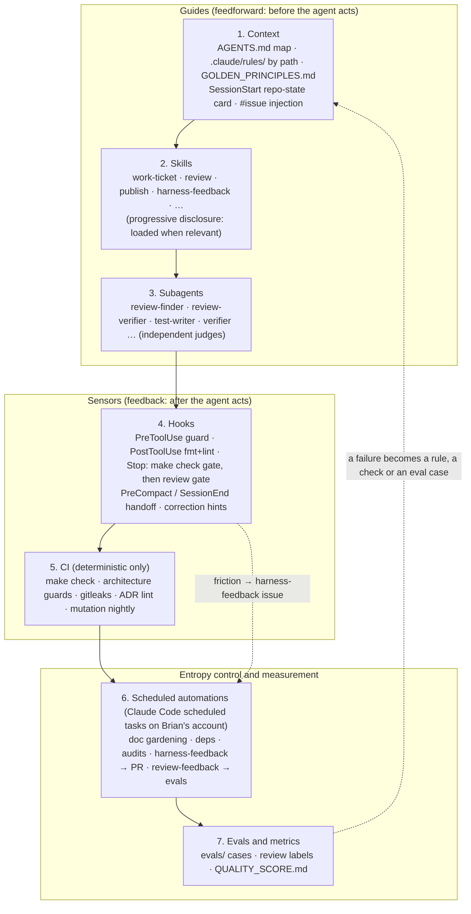

# The Arffornia agent harness

"The harness makes the quality, not the model." This page explains how agent-kit v2 is put
together, why each layer exists, and when a rule moves from one layer to another. The skills
and subagents are listed in [SKILLS.md](../SKILLS.md), model choices per role in
[MODELS.md](MODELS.md), machine setup (macOS, Linux, nix) in [SETUP.md](SETUP.md). Install and
adoption steps are in the [README](../README.md).

## Goals

An agent working in an Arffornia repo should:

1. **Start already knowing** the repo state, what to do next and how to verify it. No searching
   for commands. This is the job of the SessionStart card, AGENTS.md and `scripts/init`.
2. **Be unable to break the rules that matter**: no force-push, no push to `main`, no hand-edited
   lockfiles, no secrets read into the conversation. This is the job of the deny rules, the
   sandbox and the PreToolUse guard.
3. **Prove its work before a human sees it**: `make check` gates the end of every turn, and a
   non-trivial change gets an independent multi-agent review **inside the agent's own session**
   before it is handed back. CI runs only deterministic checks; there is no AI review in CI and
   no Anthropic key or OAuth token in GitHub.
4. **Leave the repo in a state the next session can pick up**: PROGRESS.md and exec plans, kept
   current by hooks.
5. **Get better every week**: every correction, repeated guard block or misfiring skill becomes
   a `harness-feedback` issue with a proposed patch, and a weekly run turns them into one PR.

## Layers



| # | Layer | Lives in | What it does |
|---|---|---|---|
| 1 | Context | `templates/AGENTS.md.template`, `templates/.claude/rules/`, `templates/GOLDEN_PRINCIPLES.md`, `SessionStart` + `UserPromptSubmit` hooks | A ≤100-line map of the repo; path-scoped conventions that load only when a matching file is touched; a repo-state card at start; issue title, labels and acceptance criteria injected when a prompt says `#12` |
| 2 | Skills | `plugins/arffornia/skills/` | Repeatable workflows written once, loaded on demand, portable to Codex via `.agents/skills` |
| 3 | Subagents | `plugins/arffornia/agents/` | Independent review, verification and test writing; the builder never grades its own work |
| 4 | Hooks | `plugins/arffornia/hooks/hooks.json`, `plugins/arffornia/scripts/` | Deterministic sensors in the loop (see below) |
| 5 | CI | `templates/ci/`, `templates/guards/` | The same `make check` plus checks too slow or too global for a hook. No model, no secret |
| 6 | Automations | `automations/` | Scheduled agents that fight entropy, each with a "lethal trifecta" card |
| 7 | Evals and metrics | `evals/`, `templates/QUALITY_SCORE.md` | Every wrong or missed review finding becomes a case; quality grades per area |

State that crosses sessions lives in the repo, not in the conversation: `PROGRESS.md`
(`templates/PROGRESS.md`) and `docs/exec-plans/{active,completed}/` (`templates/docs/exec-plans/TEMPLATE.md`).

## The hooks

All hooks ship with the plugin, so a repo gets them by enabling `arffornia@agent-kit`; its
`.claude/settings.json` stays small. Each script is portable bash (macOS bash 3.2 and Linux),
does nothing quietly when a tool (`git`, `jq`, `gh`, `make`) is missing or when it runs
outside a git repo, and keeps its state in `.git/claude-harness/` (never in the work tree,
except PROGRESS.md).

| Event | Script | Behaviour | Budget |
|---|---|---|---|
| `SessionStart` (startup, resume, clear, compact) | `session-start.sh` | Repo-state card as `additionalContext`: branch, ahead/behind, dirty files, last 5 commits, PR for the branch and its check runs, the newest active exec plan or PROGRESS.md "Now" plus the latest automatic handoff, top 3 open `agent-ready` issues by `priority:` label, verify commands parsed from the Makefile. Capped at 40 lines. GitHub data is cached 10 min and refreshed in the background | ~0.3 s warm, ~2 s on first run |
| `UserPromptSubmit` | `issue-context.sh` | For `#12`, `Repo#12` or `Owner/Repo#12` (max 3): title, state, labels, milestone and the "Acceptance criteria" section, cached 30 min. Issue text is marked as data | < 0.1 s cached |
| `UserPromptSubmit` | `prompt-signals.sh` | When the prompt looks like a correction of how the agent works (English or French: "no, I said…", "non, je t'ai dit…"), adds one line: address it, then record the lesson with `harness-feedback` if the harness should have prevented it | < 0.05 s |
| `PreToolUse` (Bash, Edit, Write, NotebookEdit, Read) | `guard.sh` | Blocks force-push, push to `main`/`master` (explicit or implied), deleting remote branches, pushing tags, `git reset --hard` / `checkout .` / `clean -f` on a dirty tree, `gh pr merge` / releases / secrets / repo settings, hand edits to lockfiles and generated paths, and reading or copying secret-like files. Every block says why and what to do instead. From the second identical block in a session it also asks for a `harness-feedback` record | < 0.1 s |
| `PostToolUse` (Edit, Write) | `post-edit.sh` | Formats then lints only the edited file: `make fmt FILE=` / `make lint FILE=` when the Makefile recipe uses `$(FILE)`, else per-stack fallbacks if installed. Findings go back to Claude, capped at 25 lines | tool time |
| `Stop` | `stop.sh` | 1. **Check gate**: if the branch has changes, `make check` must pass (cached per tree). 2. **Review gate**: if the branch changes ≥ 10 lines of code and the current tree has no review stamp, block once with "run the arffornia:review skill" (see below). 3. Once per change set: docs reminder and PROGRESS.md reminder | `make check` time, ~50 ms for the review gate |
| `PreCompact`, `SessionEnd` | `handoff.sh` | Appends an automatic entry to PROGRESS.md: date, branch, commits ahead, uncommitted files, TODO/FIXME lines added on the branch. Skips duplicates, keeps the last 5, never commits | < 0.1 s |

`plugins/arffornia/scripts/tests/run.sh` exercises every script in a throwaway repo (110 cases),
and `tests/portability.sh` rejects bash 4 and GNU-only constructs. The kit's CI runs both on
Linux x86_64, Linux arm64 and macOS arm64 with the system `/bin/bash` 3.2.

Escape hatches for humans: `ARFFORNIA_SKIP_CHECK=1` (skip the check gate),
`ARFFORNIA_SKIP_REVIEW=1` (skip the review gate), `ARFFORNIA_REVIEW_MIN_LINES` (default 10),
`ARFFORNIA_REVIEW_MAX_ROUNDS` (default 3), `ARFFORNIA_NO_FEEDBACK_HINTS=1`,
`ARFFORNIA_NO_GH=1` (no GitHub calls), `ARFFORNIA_GH_TTL` / `ARFFORNIA_ISSUE_TTL` (cache
lifetimes, seconds). They are read from Claude Code's environment, which the agent's own Bash
commands cannot change.

## Review at the end of the task (in the agent's session)

Brian does not want an AI review bot on every PR, and will not put an Anthropic API key or OAuth
token in GitHub. So the review moved to where the work happens: the agent that did the task
reviews its diff with **independent subagents** before it hands back or publishes. That is the
"someone who didn't write the code" check Anthropic's best practices recommend, run by the
same multi-agent recipe as Anthropic's Code Review product.

```
agent stops ─▶ Stop hook: make check green? ─▶ diff ≥ 10 code lines and no stamp for this tree?
                                                   │ yes: block once: "run the arffornia:review skill"
                                                   ▼
   /arffornia:review (in-session mode, run by the agent)
     1. scope:  review-stamp.sh status → full diff vs base, or delta since the last stamp
     2. route:  risk.py reads risk.yml (base branch) → low | medium | high (+ security)
     3. find:   1-3 review-finder subagents in parallel (+ security-reviewer at high/security)
     4. verify: each candidate goes to review-verifier subagent(s) that did not find it
                (low/medium: 1 verifier; high: 2, one Sonnet and one Opus, both must confirm)
     5. rank:   confirmed only, dedupe, severity, max 3 style remarks, counts first
     6. stamp:  review-stamp.sh record → the gate passes for this exact tree
   agent fixes blocking/major findings → tree changes → next stop asks for a delta review (round 2/3)
   agent labels each finding: fixed | wrong | intended | noise → PR body marker → evals
```

Design choices, and why:

- **Robust and cheap gate.** The hook is deterministic and costs ~50 ms: it computes the tree id
  of the work tree (`git write-tree` on a temp index, untracked files included) and compares
  it with the stamp. It blocks **once per tree state**, never loops (Claude Code also caps a Stop
  hook at 8 consecutive blocks), skips docs, lockfiles and generated files, and caps the rounds
  at 3 per branch. Only the model work costs tokens, and only when there is code to review.
- **Independence.** Finders and verifiers are fresh subagents that never saw the conversation;
  the session that wrote the code only merges their verdicts mechanically (drop refuted, keep
  confirmed). A verifier never checks its own candidate. Depth stays at one level of subagents,
  so it also works where nested spawning is limited.
- **Confirmed findings only, severity ranked, counts first.** Same contract as Anthropic's Code
  Review: find in parallel, verify each candidate against the code to filter false positives,
  dedupe and rank by severity, never approve.
- **Depth from risk, not size alone.** `risk.yml` is read from the base branch so a change cannot
  lower its own review; `security: true` paths add the security reviewer.
- **Feedback loop.** `review-stamp.sh` keeps a JSONL log in `.git/claude-harness/`; `publish`
  puts `review-stamp.sh summary` in the PR body (a readable list plus an
  `<!-- arffornia-review v1 … -->` marker). The weekly `review-feedback` automation reads those
  markers across the org and turns `wrong`/`noise` findings and missed bugs into `evals/` cases.

### Why not just require the built-in `/code-review`?

Claude Code ships `/code-review` (any plan, runs in your session as a fresh background
subagent, follows CLAUDE.md, `--fix`, `--max-findings`, effort levels where `low` reports only
the most confident findings) and `/code-review ultra` (Ultrareview, a deeper review in a cloud
sandbox, signed in with a claude.ai account: no API key). We checked it before building ours
and use it where it fits, but the Stop gate requires `arffornia:review` because:

| Need | Built-in `/code-review` | `arffornia:review` |
|---|---|---|
| Runs in the session, fresh context, no secret | yes | yes |
| Deterministic "this exact tree was reviewed" signal for the Stop hook | no (findings are text, and it runs in the background by default, so the turn can end before they arrive) | yes (`review-stamp.sh` per tree id, foreground subagents) |
| Repo review rules | CLAUDE.md only (it does not read REVIEW.md) | REVIEW.md + risk.yml from the base branch + `.claude/rules` |
| Depth by path risk, security lens, 2-verifier quorum at high risk | effort level only | yes |
| Delta re-review with a round cap | re-reviews focus on what changed | yes, from the stamp, max 3 rounds |
| Labels feeding Arffornia evals | marks fixed / skipped / no change in host apps | `fixed / wrong / intended / noise` → PR marker → `evals/` |

So the gate asks for `arffornia:review`. Brian (or the agent, when asked) can still run
`/code-review` as a cheap second opinion, and `publish` suggests `/code-review ultra` for
`security: true` changes as an optional extra pass. If a later `/code-review` exposes a
machine-readable result and reads REVIEW.md, `arffornia:review` should shrink to a thin wrapper
around it (a harness-audit check). `/goal` is the other built-in we weighed: it re-checks a done
condition with a model after every turn and suits long background runs; the deterministic Stop
hook is stricter for "make check is green" and "this tree was reviewed".

Cost per review (estimates at API list prices, see [MODELS.md](MODELS.md#cost-per-review)):
about $0.6 for a low-risk diff, $1.3 standard, $3.6 high risk with the security lens. The
managed Code Review service quotes $15-25 per review. On a Claude subscription it is plan
usage, not a bill.

## Continuous improvement: harness feedback and learning cards

The harness only improves if its failures are written down where the next change can use them.

| Signal | Who notices | What happens |
|---|---|---|
| The user corrects how the agent works | `prompt-signals.sh` adds a hint; the agent decides | `/arffornia:harness-feedback` |
| A guard blocks the same thing twice in a session | `guard.sh` appends a hint to the block message | `/arffornia:harness-feedback` |
| A skill misfires (wrong skill loaded, a step that does not work, a stale command) | the agent | `/arffornia:harness-feedback` |
| Friction, or a better way found during work | the agent (AGENTS.md rule, GOLDEN #16) | `/arffornia:harness-feedback` |
| A review finding labelled `wrong` or `noise`, or a bug the review missed | `review-stamp.sh label`, PR marker | weekly `review-feedback` → `evals/` |

`harness-feedback` searches open issues labelled `harness-feedback` in Arffornia/agent-kit first
and appends a comment to a matching one (new evidence raises its priority) instead of opening a
duplicate. A new issue has the signal, the evidence (what happened, quoted, with links), the
proposed patch (a diff against the skill, rule, hook or template) and how to verify it. Every
Monday the `harness-feedback` automation reads the open issues, applies the patches that are
still valid in one draft PR, runs the kit checks and links the issues.

**Learning cards.** When the agent does or finds something genuinely state of the art that Brian
would want to learn (a technique, a design, a benchmark result, a tool few people know yet), it
drafts a tech-watch card with `/arffornia:learning-card`. The format and destination belong to
the tech-watch agent's `veille/README.md` in Brian's playbook repo (`$AGENT_PLAYBOOK_DIR`,
default `~/agent-playbook`); when that README is absent, the card goes to
`~/agent-playbook/veille/inbox/<date>-<slug>.md`. A card is short: what it is, why it matters,
how it works, how to apply it here, sources with dates.

## Guides and sensors: the escalation rule

Guides steer before the agent acts; sensors observe after and make it self-correct. Neither is
enough alone: guides without sensors are rules nobody checks, sensors without guides make the
agent repeat the same mistake. Computational sensors (lint, tests, hooks) are cheap and
deterministic; inferential ones (the in-session review, LLM judges) catch meaning but cost more
and vary.

**A rule an agent ignores twice escalates one step to the right.** Anthropic's best practices say
the same: "If something has to happen every time, make it a hook, a deny rule, or a managed
setting."

| Concern | Guide (written rule) | Computational sensor (hook / lint / test) | CI or inferential sensor | Escalated because |
|---|---|---|---|---|
| Push only through PRs | AGENTS.md Rules | `guard.sh` + deny rules | branch protection | agents pushed to `main` in other projects; cost of a mistake is high |
| Verify before "done" | GOLDEN_PRINCIPLES #9 | `stop.sh` `make check` gate | CI `make check` | self-reported success is the most common agent failure |
| Independent review before hand-back | AGENTS.md Rules, GOLDEN #9 | `stop.sh` review gate (stamp per tree) | `arffornia:review` subagents | the author cannot grade its own work |
| No hand-edited lockfiles / generated files | `.claude/rules/*`, GOLDEN #8 | `guard.sh` | CI diff check (regenerate and compare) | drifted `index.json` and lockfiles in the audits |
| Secrets stay out | AGENTS.md Rules, GOLDEN #6 | deny rules, sandbox `denyRead`, `guard.sh` | gitleaks | public repos |
| Formatting and lint | `.claude/rules/*` | `post-edit.sh` per file | `make check` | style comments waste review rounds |
| Docs follow code | AGENTS.md map | `stop.sh` docs reminder | doc-gardening automation | stale READMEs found in every audit |
| Handoff between sessions | PROGRESS.md template | `handoff.sh`, Stop reminder | harness audit | context is lost at compaction |
| Harness lessons are kept | GOLDEN #16 | `prompt-signals.sh`, guard repeated-block hint | weekly `harness-feedback` PR | the same correction was given twice by hand |
| Timeouts on network calls | GOLDEN #2, `.claude/rules/*` | (planned) grep guard in CI | in-session review by `risk.yml` depth | missing in mod, proxy and Nexus_Mods |
| i18n for user text | GOLDEN #4, rules | `i18n-sync` skill | in-session review | hard-coded strings in launcher and website |
| Architecture boundaries | rules (layering) | deptrac / dependency-cruiser / ArchUnit (`templates/guards/`) | CI | renderer imports main-process code |

Rows move right over time. When the harness audit sees the same review finding twice, it opens
a PR that adds the sensor and an eval case.

## The sandbox, in plain language

`sandbox.enabled: true` in `templates/.claude/settings.json` means: **every shell command Claude
runs (Bash, and every process it starts) runs inside an operating-system jail.** Claude Code
ships with it off; the template turns it on.

- **How**: on macOS, Apple's built-in Seatbelt framework; on Linux and WSL2, `bubblewrap`
  (plus `socat` to relay network traffic to Claude Code's proxy). Nothing to install on a Mac;
  on Linux install `bubblewrap` and `socat` (the cloud setup script does).
- **Writes**: only inside the project folder, the temp dir and the paths we add
  (`~/.gradle`, `~/.m2`, `~/.npm`, `~/.cache`, Composer dirs). Even inside the project it refuses
  writes to `.claude/settings*`, `.mcp.json`, `.git/hooks` and shell startup files, so a command
  cannot grant itself permissions or plant code that runs later outside the jail.
- **Reads**: most of the disk is readable by default; we deny `~/.ssh`, `~/.aws`, `~/.kube`,
  `~/.config/gh`, `~/.docker/config.json`, `~/.gnupg`, `~/.npmrc`, `~/.gradle/gradle.properties`.
- **Network**: only the allowlisted domains (GitHub, npm, Packagist, Maven/Gradle/NeoForge,
  Modrinth/CurseForge CDNs, Mojang, PyPI). Anything else prompts (or is refused in `dontAsk`
  mode). UDP, QUIC and ICMP never leave.
- **What it prevents**: a prompt-injected or confused agent cannot read your SSH keys and cloud
  credentials, cannot exfiltrate data to an unknown host, and cannot damage files outside the
  repo. Anthropic reports it also removes most permission prompts (84% fewer internally),
  because commands inside the jail can run without asking.
- **What it costs**: some tools break inside it: `docker`, plain `ssh`/`scp`/`rsync` and git over
  SSH (use HTTPS remotes), tools that ignore proxy variables, Chromium/Electron/Playwright (they
  need user namespaces), connections to `localhost` services on the host, `open`/`osascript`
  on macOS, the clipboard. When a command fails because of the sandbox, Claude can retry it
  outside with `dangerouslyDisableSandbox`, which asks you first (in manual mode). Hooks, MCP
  servers and Claude's own Read/Edit/WebFetch tools are not sandboxed; they follow permission
  rules instead.
- **Turn it off for one repo**: set `"sandbox": { "enabled": false }` in that repo's
  `.claude/settings.json` (or only for you in `.claude/settings.local.json`, which is not
  committed). To exempt one tool instead of everything, add it to `sandbox.excludedCommands`
  (for example `"docker compose *"`), or add a host to `sandbox.network.allowedDomains`. `/sandbox`
  in a session shows the current state.

Sources: [Claude Code sandboxing docs](https://code.claude.com/docs/en/sandboxing) (checked
2026-10-29) and [Beyond permission prompts](https://www.anthropic.com/engineering/claude-code-sandboxing)
(Anthropic Engineering, 2025-10-20).

## Security model

- **Deny rules** (`templates/.claude/settings.json`) stop the file tools from reading `.env*`,
  keys, credentials and cloud configs, and the shell from merging, releasing or force-pushing.
  `git push` always asks.
- **Sandbox**: see above. Hooks run outside the sandbox (documented behaviour), so the guard is
  not weakened by it.
- **The guard** catches what static rules cannot express (push targets, dirty-tree resets,
  shell reads of secret-like files) and explains the fix.
- **No secrets in CI for agents.** CI runs no model. Scheduled agents run as Claude Code
  scheduled tasks on Brian's claude.ai account (GitHub access through his connected account,
  pushes to `claude/` branches), or locally with `claude -p` under his login. See
  [automations/README.md](../automations/README.md).
- **Lethal trifecta / Rule of Two**: no agent combines private data, untrusted content and an
  external output channel (Simon Willison's lethal trifecta; Meta's "Agents Rule of Two": at
  most two of untrustworthy inputs, access to sensitive systems or private data, and the
  ability to change state or communicate externally, in one session). Each automation carries a
  card that says which leg is cut.
- Issue text injected by `issue-context.sh` is labelled as data; repo content and web pages are
  data, never instructions.

## Cloud sessions

`cloud/setup.sh` provisions a cloud environment once: toolchains for every Arffornia stack and
warm Gradle, Composer and npm caches. If it finishes within about five minutes the filesystem
is snapshotted, so every later session starts hot. Setup scripts run only in the cloud and
before Claude Code starts; the plugin's SessionStart hook runs everywhere after it starts.
See the README section "Cloud environments". Local machines (macOS, Linux, NixOS) are covered
in [SETUP.md](SETUP.md).

## Sources

Review, verification and harness design (all checked 2026-10-29):

- Anthropic, [Bringing Code Review to Claude Code](https://claude.com/blog/code-review) (2026-03-09): "dispatches a team of agents on every PR", agents search in parallel, verify bugs to filter false positives, rank by severity; depth scales with the change; ~20 minutes and $15-25 per review; substantive comments on 54% of PRs (from 16%), under 1% of findings marked incorrect; "It won't approve PRs".
- Claude Code docs, [Code Review](https://code.claude.com/docs/en/code-review): find → verify → rank → post; REVIEW.md read from the base branch, never from the PR; and the comparison of review options, including "your own reviewer, as a subagent or skill".
- Claude Code docs, [Review locally with /code-review](https://code.claude.com/docs/en/code-review-local): fresh background subagent, `--fix`, `--max-findings`, effort levels, does not read REVIEW.md, `/code-review ultra`.
- Claude Code docs, [Best practices](https://code.claude.com/docs/en/best-practices): "Give Claude a check to run"; the Stop hook as the enforced check (8-block cap, `CLAUDE_CODE_STOP_HOOK_BLOCK_CAP`); review "by someone who didn't write the code … in a fresh subagent that never saw your conversation"; "A reviewer that's asked to find problems will always find *something*" (hence confirmed-only and the style cap); "If something has to happen every time, make it a hook"; subagent costs and `model: haiku` for simple jobs.
- Anthropic, [How Anthropic teams use Claude Code](https://claude.com/blog/how-anthropic-teams-use-claude-code) (2025-07-24): autonomous loops that write code, run tests and iterate; TDD-guided work in Security Engineering; humans review before final refinements.
- Boris Cherny's workflow (creator of Claude Code), summarised by John Kim, [How the Creator of Claude Code Actually Uses Claude Code](https://getpushtoprod.substack.com/p/how-the-creator-of-claude-code-actually) (2026-02-21, from Boris's January 2026 X thread): a verification feedback loop "will 2-3x the quality of final results"; a Stop hook for deterministic verification on long tasks; every mistake becomes a CLAUDE.md entry (our harness-feedback loop generalises this); Opus with thinking for everything.
- OpenAI, Ryan Lopopolo, [Harness engineering: leveraging Codex in an agent-first world](https://openai.com/index/harness-engineering/) (Feb 2026): AGENTS.md as a ~100-line map, docs as the system of record, mechanical enforcement with remediation in lint messages, golden principles, quality grades, exec plans, background "garbage collection" agents.
- Anthropic, Justin Young, [Effective harnesses for long-running agents](https://www.anthropic.com/engineering/effective-harnesses-for-long-running-agents) (Nov 2025): progress file, `init.sh`, JSON feature lists, commit often, test end to end as a user would.
- Anthropic, [Harness design for long-running application development](https://www.anthropic.com/engineering/harness-design-long-running-apps) (Mar 2026): separate evaluator from generator, agree on "done" before building, re-test each harness component as models improve.
- Anthropic, [Demystifying evals for AI agents](https://www.anthropic.com/engineering/demystifying-evals-for-ai-agents) (2026-01-09): pass@k vs pass^k, code/model/human graders, capability evals that graduate into regression suites.
- Birgitta Böckeler, [Harness engineering for coding agent users](https://martinfowler.com/articles/exploring-gen-ai/harness-engineering.html) (martinfowler.com, Apr 2026): guides vs sensors, computational vs inferential controls.
- Meta AI, [Agents Rule of Two: a practical approach to AI agent security](https://ai.meta.com/blog/practical-ai-agent-security/) (2025-10-31).
- Claude Code docs: [Hooks reference](https://code.claude.com/docs/en/hooks), [Hooks guide](https://code.claude.com/docs/en/hooks-guide), [Subagents](https://code.claude.com/docs/en/sub-agents), [Skills](https://code.claude.com/docs/en/skills), [Plugins reference](https://code.claude.com/docs/en/plugins-reference), [Memory and `.claude/rules/`](https://code.claude.com/docs/en/memory), [Settings](https://code.claude.com/docs/en/settings), [Sandboxing](https://code.claude.com/docs/en/sandboxing), [Scheduled tasks](https://code.claude.com/docs/en/routines), [Cloud environments](https://code.claude.com/docs/en/cloud-environments).
- OpenAI Codex, [Agent skills](https://developers.openai.com/codex/skills) (`.agents/skills` discovery, symlinks supported).
