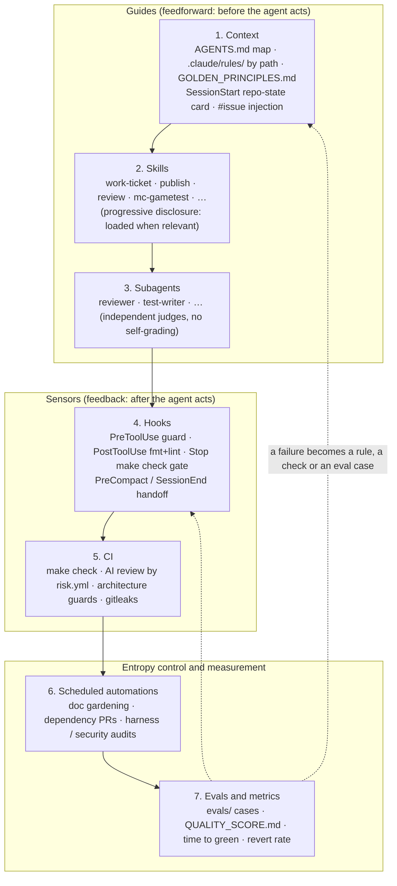

# The Arffornia agent harness

"The harness makes the quality, not the model." This page explains how agent-kit v2 is put
together, why each layer exists, and when a rule moves from one layer to another. The skills
and subagents are listed in [SKILLS.md](../SKILLS.md). Install and adoption steps are in the
[README](../README.md).

## Goals

An agent working in an Arffornia repo should:

1. **Start already knowing** the repo state, what to do next and how to verify it. No searching
   for commands. This is the job of the SessionStart card, AGENTS.md and `scripts/init`.
2. **Be unable to break the rules that matter**: no force-push, no push to `main`, no hand-edited
   lockfiles, no secrets read into the conversation. This is the job of the deny rules, the
   sandbox and the PreToolUse guard.
3. **Prove its work before a human sees it**: `make check` gates the end of every turn, a
   separate reviewer subagent reviews, and CI runs the same checks again.
4. **Leave the repo in a state the next session can pick up**: PROGRESS.md and exec plans, kept
   current by hooks.

## Layers

| # | Layer | Lives in | What it does |
|---|---|---|---|
| 1 | Context | `templates/AGENTS.md.template`, `templates/.claude/rules/`, `templates/GOLDEN_PRINCIPLES.md`, `SessionStart` + `UserPromptSubmit` hooks | A ≤100-line map of the repo; path-scoped conventions that load only when a matching file is touched; a repo-state card at start; issue title, labels and acceptance criteria injected when a prompt says `#12` |
| 2 | Skills | `plugins/arffornia/skills/` (Builder B) | Repeatable workflows written once, loaded on demand, portable to Codex via `.agents/skills` |
| 3 | Subagents | `plugins/arffornia/agents/` (Builder B) | Independent review and test writing; the builder never grades its own work |
| 4 | Hooks | `plugins/arffornia/hooks/hooks.json`, `plugins/arffornia/scripts/` | Deterministic sensors in the loop (see below) |
| 5 | CI | `templates/ci/` (Builder C) | The same `make check` plus checks too slow or too global for a hook |
| 6 | Automations | `automations/` (Builder C) | Scheduled agents that fight entropy, each with a "lethal trifecta" card |
| 7 | Evals and metrics | `evals/` (Builder B), `templates/QUALITY_SCORE.md` | Every reverted PR or wrong review finding becomes a case; quality grades per area |

State that crosses sessions lives in the repo, not in the conversation: `PROGRESS.md`
(`templates/PROGRESS.md`) and `docs/exec-plans/{active,completed}/` (`templates/docs/exec-plans/TEMPLATE.md`).

## The hooks

All hooks ship with the plugin, so a repo gets them by enabling `arffornia@agent-kit`; its
`.claude/settings.json` stays small. Each script is portable bash, does nothing quietly when
a tool (`git`, `jq`, `gh`, `make`) is missing or when it runs outside a git repo, and keeps its
state in `.git/claude-harness/` (never in the work tree, except PROGRESS.md).

| Event | Script | Behaviour | Budget |
|---|---|---|---|
| `SessionStart` (startup, resume, clear, compact) | `session-start.sh` | Repo-state card as `additionalContext`: branch, ahead/behind, dirty files, last 5 commits, PR for the branch and its check runs, the newest active exec plan or PROGRESS.md "Now" plus the latest automatic handoff, top 3 open `agent-ready` issues by `priority:` label, verify commands parsed from the Makefile. Capped at 40 lines. GitHub data is cached 10 min and refreshed in the background | ~0.3 s warm, ~2 s on first run |
| `UserPromptSubmit` | `issue-context.sh` | For `#12`, `Repo#12` or `Owner/Repo#12` (max 3): title, state, labels, milestone and the "Acceptance criteria" section, cached 30 min. Issue text is marked as data | < 0.1 s cached |
| `PreToolUse` (Bash, Edit, Write, NotebookEdit, Read) | `guard.sh` | Blocks force-push, push to `main`/`master` (explicit or implied), deleting remote branches, pushing tags, `git reset --hard` / `checkout .` / `clean -f` on a dirty tree, `gh pr merge` / releases / secrets / repo settings, hand edits to lockfiles and generated paths (`src/generated/**`, `docs/assets/diagrams/**`, Provisioning `config/*/index.json`, `vendor/`, build output), and reading or copying secret-like files through Read or the shell. Every block says why and what to do instead | < 0.1 s |
| `PostToolUse` (Edit, Write) | `post-edit.sh` | Formats then lints only the edited file: `make fmt FILE=` / `make lint FILE=` when the Makefile recipe uses `$(FILE)`, else per-stack fallbacks if installed (Pint, Prettier, ESLint, `php -l`, shellcheck, jq, yamllint). Findings go back to Claude, capped at 25 lines | tool time |
| `Stop` | `stop.sh` | Gate: if the branch has changes, `make check` must pass; a pass is cached per tree state. Then, once per change set: a docs reminder (source changed, docs did not) and a PROGRESS.md reminder (work unfinished, handoff not written). With `stop_hook_active` the reminders are skipped and the gate only re-runs if the tree changed | `make check` time |
| `PreCompact`, `SessionEnd` | `handoff.sh` | Appends an automatic entry to PROGRESS.md: date, branch, commits ahead, uncommitted files, TODO/FIXME lines added on the branch. Skips duplicates, keeps the last 5, never commits | < 0.1 s |

`plugins/arffornia/scripts/tests/run.sh` exercises every script in a throwaway repo
(82 cases). Run it after any change to a hook.

Escape hatches for humans: `ARFFORNIA_SKIP_CHECK=1` (skip the Stop gate),
`ARFFORNIA_NO_GH=1` (no GitHub calls), `ARFFORNIA_GH_TTL` / `ARFFORNIA_ISSUE_TTL` (cache
lifetimes, seconds). They are read from Claude Code's environment, which the agent's own
Bash commands cannot change.

## Guides and sensors: the escalation rule

Guides steer before the agent acts; sensors observe after and make it self-correct. Neither is
enough alone: guides without sensors are rules nobody checks, sensors without guides make the
agent repeat the same mistake. Computational sensors (lint, tests, hooks) are cheap and
deterministic; inferential ones (AI review, LLM judges) catch meaning but cost more and vary.

**A rule an agent ignores twice escalates one step to the right.**

| Concern | Guide (written rule) | Computational sensor (hook / lint / test) | CI / inferential sensor | Escalated because |
|---|---|---|---|---|
| Push only through PRs | AGENTS.md Rules | `guard.sh` + deny rules | branch protection | agents pushed to `main` in other projects; cost of a mistake is high |
| Verify before "done" | GOLDEN_PRINCIPLES #9 | `stop.sh` `make check` gate | CI `make check`, reviewer subagent | self-reported success is the most common agent failure |
| No hand-edited lockfiles / generated files | `.claude/rules/*`, GOLDEN #8 | `guard.sh` | CI diff check (regenerate and compare) | drifted `index.json` and lockfiles in the audits |
| Secrets stay out | AGENTS.md Rules, GOLDEN #6 | deny rules, sandbox `denyRead`, `guard.sh` | gitleaks | public repos |
| Formatting and lint | `.claude/rules/*` | `post-edit.sh` per file | `make check` | style comments waste review rounds |
| Docs follow code | AGENTS.md map | `stop.sh` docs reminder | doc-gardening automation | stale READMEs found in every audit |
| Handoff between sessions | PROGRESS.md template | `handoff.sh`, Stop reminder | harness audit | context is lost at compaction |
| Timeouts on network calls | GOLDEN #2, `.claude/rules/*` | (planned) grep guard in CI | AI review by `risk.yml` depth | missing in mod, proxy and Nexus_Mods |
| i18n for user text | GOLDEN #4, rules | `i18n-sync` skill | AI review | hard-coded strings in launcher and website |
| Architecture boundaries | rules (layering) | deptrac / dependency-cruiser / ArchUnit (`templates/guards/`) | CI | renderer imports main-process code |

Rows move right over time. When the harness audit sees the same review finding twice, it opens
a PR that adds the sensor and an eval case.

## Security model

- **Deny rules** (`templates/.claude/settings.json`) stop the file tools from reading `.env*`,
  keys, credentials and cloud configs, and the shell from merging, releasing or force-pushing.
  `git push` always asks.
- **Sandbox** (`sandbox.enabled`) confines shell commands: writes limited to the project, temp
  and the package caches; reads of `~/.ssh`, `~/.aws`, `~/.kube`, `~/.config/gh` denied; network
  limited to the registries Arffornia builds need. Hooks run outside the sandbox (documented
  behaviour), so the guard is not weakened by it.
- **The guard** catches what static rules cannot express (push targets, dirty-tree resets,
  shell reads of secret-like files) and explains the fix.
- **Lethal trifecta**: no automation combines private data, untrusted content and an external
  output channel. Each automation in `automations/` carries a card that says which two it has.
- Issue text injected by `issue-context.sh` is labelled as data; repo content and web pages are
  data, never instructions.

## Cloud sessions

`cloud/setup.sh` provisions a cloud environment once: toolchains for every Arffornia stack and
warm Gradle, Composer and npm caches. If it finishes within about five minutes the filesystem
is snapshotted, so every later session starts hot. Setup scripts run only in the cloud and
before Claude Code starts; the plugin's SessionStart hook runs everywhere after it starts.
See the README section "Cloud environments".

## Sources

- OpenAI, Ryan Lopopolo, [Harness engineering: leveraging Codex in an agent-first world](https://openai.com/index/harness-engineering/) (Feb 2026): AGENTS.md as a ~100-line map, docs as the system of record, mechanical enforcement with remediation in lint messages, golden principles, quality grades, exec plans, background "garbage collection" agents.
- Anthropic, Justin Young, [Effective harnesses for long-running agents](https://www.anthropic.com/engineering/effective-harnesses-for-long-running-agents) (Nov 2025): progress file, `init.sh`, JSON feature lists (harder to corrupt than Markdown), commit often, test end to end as a user would.
- Anthropic, [Harness design for long-running application development](https://www.anthropic.com/engineering/harness-design-long-running-apps) (Mar 2026): separate evaluator from generator, agree on "done" before building, re-test each harness component as models improve.
- Birgitta Böckeler, [Harness engineering for coding agent users](https://martinfowler.com/articles/exploring-gen-ai/harness-engineering.html) (martinfowler.com, Apr 2026): guides (feedforward) vs sensors (feedback), computational vs inferential controls.
- Claude Code docs: [Hooks reference](https://code.claude.com/docs/en/hooks), [Hooks guide](https://code.claude.com/docs/en/hooks-guide), [Plugins reference](https://code.claude.com/docs/en/plugins-reference), [Memory and `.claude/rules/`](https://code.claude.com/docs/en/memory), [Settings](https://code.claude.com/docs/en/settings), [Permissions](https://code.claude.com/docs/en/permissions), [Sandboxing](https://code.claude.com/docs/en/sandboxing), [Cloud environments and setup scripts](https://code.claude.com/docs/en/cloud-environments), [Skills](https://code.claude.com/docs/en/skills).
- OpenAI Codex, [Agent skills](https://developers.openai.com/codex/skills) (`.agents/skills` discovery, symlinks supported).
