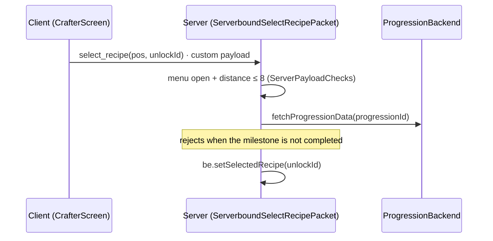

# Explainer shape

````markdown
# <Module> - <the question, e.g. "How a recipe selection reaches the Crafter">

**Summary.** 3-5 sentences: what it is for, who calls it, what it owns, the one thing a
newcomer must know.



## Walkthrough
1. `src/.../CrafterScreen.java:120` - the client sends ... 
2. `src/.../ServerboundSelectRecipePacket.java:52` - the server checks ...

## Invariants
- <what must always hold, with the line that enforces it>

## Gotchas
- <surprising behaviour, with source>

## Risks
- <security / concurrency / data loss facts, with source>

## Code vs docs
- <where docs say otherwise: doc path:line vs code path:line>

Sources: <list of files read>
````

When the caller wants it kept, it goes to the repo's `docs/` (or the docs repo
`docs/components/<repo>.md`), not to a new top-level file.
